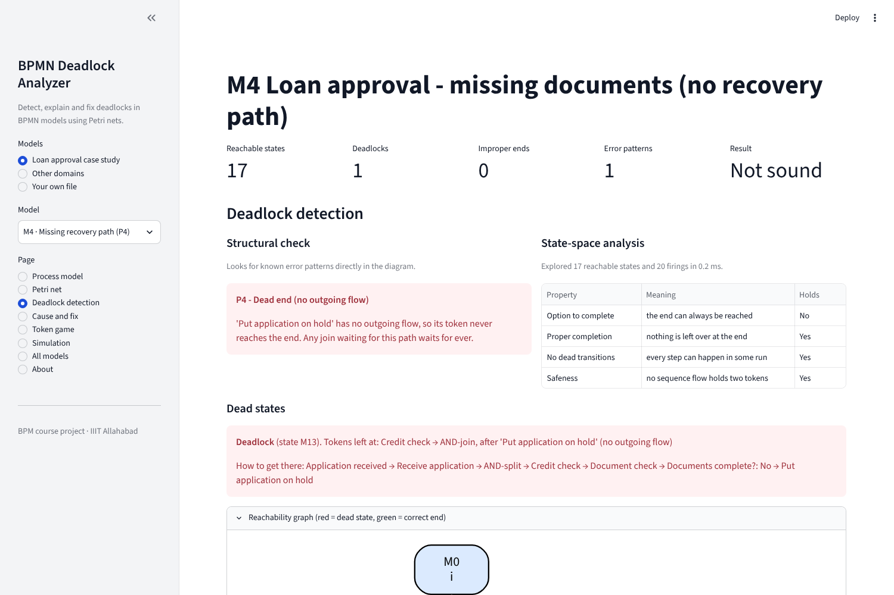
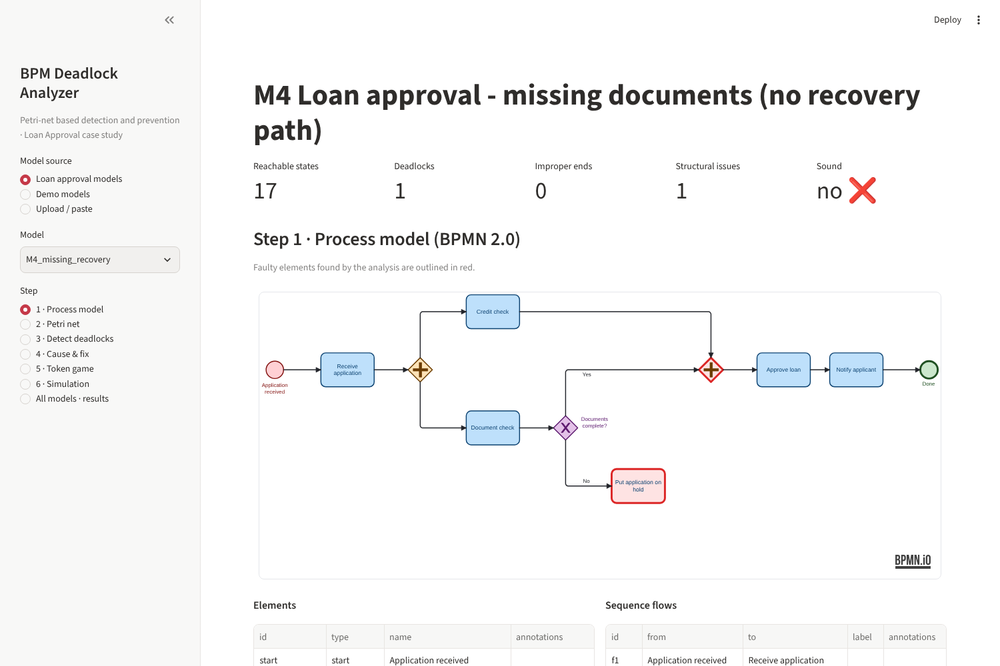
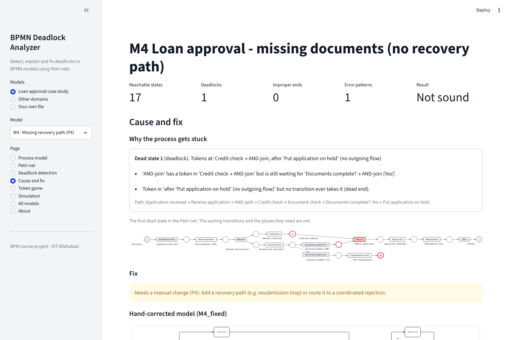
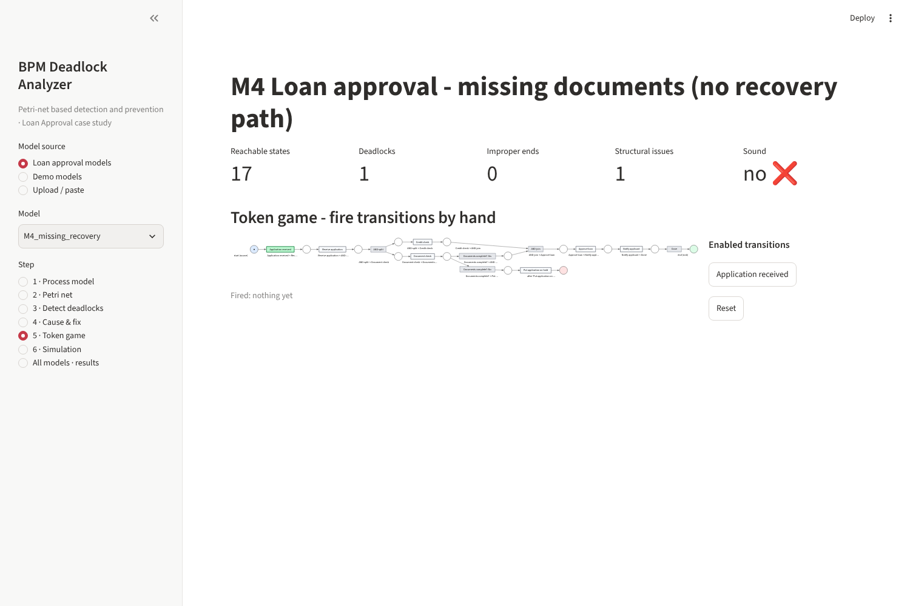

# BPMN Deadlock Analyzer

**Detect, explain and fix deadlocks in BPMN process models using Petri nets.**


A process model can look correct and still let a case get stuck: a join that waits for a branch that
never started, a loop that can't be entered, two tasks each holding the resource the other needs.
This tool reads a BPMN 2.0 model, translates it into a Petri net, finds every state where a case can
get stuck, explains why, repairs the model, and checks the repaired version again.

**Live demo:** https://bpm-deadlock.streamlit.app/



---

## Contents

- [Features](#features)
- [Quick start](#quick-start)
- [How it works](#how-it-works)
- [Models](#models)
- [Results](#results)
- [Project structure](#project-structure)
- [Testing and reproducing the results](#testing-and-reproducing-the-results)
- [Deployment](#deployment)
- [References](#references)
- [Team](#team)

## Features

- **BPMN in, Petri net out.** Reads `.bpmn` files from Camunda Modeler or bpmn.io and maps them to a
  workflow net. A correctness check confirms that every element and flow is mapped.
- **Two kinds of detection.** A fast structural check for six known error patterns, and a full
  state-space search that checks soundness (option to complete, proper completion, no dead
  transitions) and safeness.
- **Explanations.** For every dead state: where the tokens are, which step is waiting for what, and
  the exact sequence of steps that leads there.
- **Resource deadlocks.** Shared resources (an officer, a system session, a hospital bed) are modelled
  as places. Circular waits are traced to an empty siphon.
- **Repairs.** Mismatched gateways are fixed directly in the BPMN file, which you can download.
  Circular waits get a control place, and the tool checks that it blocks nothing that worked before.
- **Interactive.** A token game to step through the process by hand, and a timed simulation with
  task durations and branch probabilities.

| Process model | Cause and fix | Token game |
|---|---|---|
|  |  |  |

## Quick start

Requires Python 3.10 or newer.

```bash
git clone https://github.com/devanshrai23/bpm-deadlock.git
cd bpm-deadlock
python -m venv .venv
source .venv/bin/activate          # Windows: .venv\Scripts\activate
pip install -r requirements.txt
streamlit run app.py
```

The app opens at http://localhost:8501. It works offline: the BPMN viewer is bundled in `static/` and
Petri nets are drawn in the browser, so Graphviz does not need to be installed.

To analyse your own model, choose **Your own file** in the sidebar and upload a `.bpmn` file, or paste
the XML.

## How it works

```
 BPMN model ──► Petri net ──► detection ──► cause ──► fix ──► re-check
                                  ▲                            │
                                  └────────────────────────────┘
```

| Step | What happens | Code |
|---|---|---|
| 1. Model | The BPMN XML is parsed into nodes, flows and annotations. | `src/bpmn_parser.py` |
| 2. Petri net | Each sequence flow becomes a place and each task a transition. AND gateways become one transition, XOR gateways one transition per branch. | `src/transformer.py`, `src/petri_net.py` |
| 3a. Structural check | Searches the diagram for the error patterns below. Instant, and it also finds errors that are hidden behind other errors. | `src/structural.py` |
| 3b. State-space analysis | Breadth-first search over all reachable states. Reports deadlocks, improper completions and unsafe flows, each with a witness trace. | `src/reachability.py` |
| 4. Cause | Explains each dead state and finds siphons that empty in a circular wait. | `src/diagnosis.py`, `src/siphons.py` |
| 5. Fix | Corrects gateways in the BPMN XML, or adds a control place for each problem siphon. | `src/prevention.py` |
| 6. Re-check | Runs the fixed model through steps 2 and 3 again and lists what changed. | `src/pipeline.py`, `src/evolution.py` |

**Error patterns**

| Code | Pattern | Effect | Automatic fix |
|---|---|---|---|
| P1 | XOR-split closed by an AND-join | deadlock | join becomes XOR |
| P2 | AND-join at a loop entry | deadlock | join becomes XOR |
| P3 | AND-split closed by an XOR-join | steps run twice, improper completion | join becomes AND |
| P4 | Element without an outgoing flow | deadlock | manual: add a recovery path |
| P5 | Element that can't be reached | dead activity | manual |
| P6 | Two resources taken in opposite orders | circular wait | control place |

**Annotations.** Durations, probabilities and resources are written in the standard BPMN
*documentation* field, so the files stay valid BPMN. In Camunda Modeler: select the element, then
Properties → General → Documentation.

| Where | Example |
|---|---|
| Process | `resources: officer=1, credit_system=1` |
| Task | `time: 20; acquire: officer`, `release: officer`, `uses: officer` |
| Sequence flow | `prob: 0.3` |

## Models

All models are in `models/` as BPMN 2.0 files with diagram layout, so they open in Camunda Modeler
or at [demo.bpmn.io](https://demo.bpmn.io). They are generated by `tools/generate_models.py`.

**Loan approval case study**

| Model | Description | Result |
|---|---|---|
| `M1_sequential` | Plain sequence of steps | sound |
| `M2_parallel` | Credit and document checks in parallel | sound |
| `M3_wrong_join` | "Risk level?" XOR-split closed by an AND-join | 2 deadlocks (P1) |
| `M4_missing_recovery` | "Put on hold" path leads nowhere | 1 deadlock (P4) |
| `M5_resource_deadlock` | Officer and credit system taken in opposite orders | 1 deadlock (P6) |
| `M6_full_timed` | Corrected model with durations and probabilities | sound |
| `C1_complex` | End-to-end process with five defects (P1, P2, P3, P4, P6) | 3 deadlocks at first, more appear as earlier ones are fixed |

`M3_fixed`, `M4_fixed`, `M5_fixed` and `C1_fixed` are the hand-corrected versions. All are sound.

**Other domains**

| Model | Description | Result |
|---|---|---|
| `D1_order_fulfilment` | Order handling | sound |
| `D2_insurance_claim` | XOR-split closed by an AND-join | 2 deadlocks (P1) |
| `D3_leave_request` | AND-split closed by an XOR-join | improper completion (P3) |
| `D4_hospital_admission` | Bed and doctor taken in opposite orders | 1 deadlock (P6) |
| `D5_purchase_order_loop` | AND-join at a loop entry | 1 deadlock (P2) |

## Results

- All 8 faulty models are repaired and verified as sound. Every analysis takes under 5 ms.
- Our soundness verdicts match pm4py's WOFLAN check on all 16 models.
- The control places for the resource deadlocks (M5, D4, C1) keep every state from which the process
  can still finish, so they block nothing that worked before.
- On the parallel-branch benchmark of Kräuter et al. our state counts are theirs plus one in every
  case, so the Petri-net encoding is as compact as theirs.

**The complex model C1** shows why the re-check loop matters. Its first defects stop every case early,
so the later ones never show up in the state space. Fixing it one round at a time reveals them:

| Round | Fix | States | Deadlocks | Sound |
|---|---|---|---|---|
| 0 | none | 32 | 3 | no |
| 1 | gateway fixes (P1, P2, P3) | 217 | 2 | no |
| 2 | redesign of the dead end (P4) | 218 | 1 | no |
| 3 | control place for the circular wait (P6) | 212 | 0 | yes |

The full results are in `results/results.csv` and `results/complex_case.csv`. The project report
(IEEE format) is in `report/`.

## Project structure

```
bpm-deadlock/
├── app.py                  Streamlit web app
├── src/                    analysis library (no Streamlit code)
│   ├── bpmn_parser.py      read BPMN XML
│   ├── transformer.py      BPMN → Petri net, mapping check
│   ├── petri_net.py        Petri net and firing rule
│   ├── structural.py       error patterns P1–P6
│   ├── reachability.py     state-space analysis, soundness, safeness
│   ├── diagnosis.py        explanation of dead states
│   ├── siphons.py          minimal and problem siphons
│   ├── prevention.py       gateway fixes, control places
│   ├── evolution.py        changes between two model versions
│   ├── simulate.py         timed simulation
│   ├── pipeline.py         runs all steps for one model
│   └── visualize.py        Graphviz and bpmn-js drawing helpers
├── models/                 BPMN models
├── tests/                  pytest suite
├── tools/                  model generator, figures, benchmark, cross-check
├── results/                result tables, figures, screenshots
├── report/                 IEEE report (LaTeX source and PDF)
├── static/                 bundled bpmn-js viewer
└── .streamlit/config.toml  app theme
```

## Testing and reproducing the results

```bash
pip install -r requirements-dev.txt
python -m pytest -q                  # 58 tests
python tools/complex_case.py         # round-by-round repair of C1
python tools/benchmark_parallel.py   # parallel-branch benchmark
python tools/crosscheck_pm4py.py     # compare soundness with pm4py
python tools/make_figures.py         # report figures (needs Graphviz installed)
```

The report compiles with any LaTeX distribution that has the IEEEtran class. On Overleaf, upload
`report/report_overleaf.zip` as a new project.

## Deployment

The app is ready for [Streamlit Community Cloud](https://streamlit.io/cloud):

1. Sign in with GitHub and choose **Create app → Deploy a public app from GitHub**.
2. Repository `devanshrai23/bpm-deadlock`, branch `main`, main file `app.py`.
3. Under **Advanced settings**, choose Python 3.12.
4. Deploy. The first build takes a few minutes.

`requirements.txt` holds only what the app needs (Streamlit, pinned to the tested version, and
pandas). Testing and figure tools are in `requirements-dev.txt`, so they don't slow down the build.

## References

1. T. Kräuter, P. Stünkel, A. Rutle, H. König, Y. Lamo. *Instantaneous, Comprehensible, and Fixable
   Soundness Checking of Realistic BPMN Models.* arXiv:2407.03965, 2024.
2. Z. Zhang, F. Ni, J. Liu, N. Chen, X. Zhou. *Collaborative Modeling of BPMN and HCPN: Formal Mapping
   and Iterative Evolution of Process Models for Scenario Changes.* Information 16(4):323, 2025.
3. S. G. Wang, X. Guo, O. Karoui, M. C. Zhou, D. You, A. Abusorrah. *A Refined Siphon-Based Deadlock
   Prevention Policy for a Class of Petri Nets.* IEEE Trans. Syst., Man, Cybern.: Systems
   53(1):191–203, 2023.
4. W. M. P. van der Aalst. *The Application of Petri Nets to Workflow Management.* J. Circuits,
   Systems and Computers 8(1):21–66, 1998.
5. T. Murata. *Petri Nets: Properties, Analysis and Applications.* Proc. IEEE 77(4):541–580, 1989.

The BPMN diagrams are drawn with [bpmn-js](https://github.com/bpmn-io/bpmn-js), included under its own
license (`static/BPMN-JS-LICENSE.txt`).
